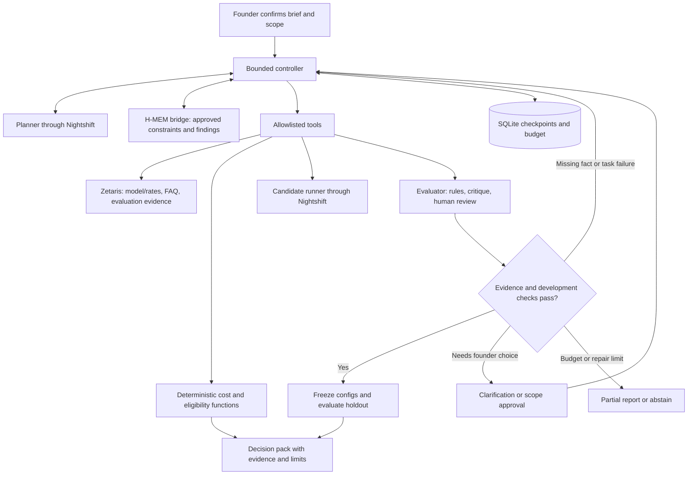

# Architecture: bounded founder decision agent

Version 3.3 | October 23, 2026 (late evening) | Proposed architecture, no integration yet implemented | Aligned to the Open Agent Hackathon Technical Execution Guide; G42 Agentathon templates are non-binding (see PRD header)

Depends on [PRD](01-Product-Requirements.md). Requirements and source precedence are in [the reading guide](00-Changes-and-Reading-Guide.md). Narin owns integration/deployment; Pradeep's backend/engine assignment remains proposed.

## 1. Stack and responsibilities

Build a Python/Streamlit app for forms, deterministic costs, bounded control, evaluation, trace view, and export, adding the required sponsor capabilities rather than custom infrastructure. If any Streamlit or cost-model code predates October 22, 00:00 UTC, it is a pre-existing component: declare it in the submission form and keep it in an identifiable module so judges can see what was built during the event.

Repository layout follows the guide's suggested structure so judges find things where they expect them:

```text
/project-root
│── app/                 # controller, roles, contracts, cost tools, report builder
│── app/adapters/        # Zetaris REST and Nightshift adapters (live + sample implementations)
│── app/engines/hmem/    # H-MEM bridge and pinned sponsor reference
│── data/                # small curated FAQ/rate samples + data/README.md (source, license, subset, regen)
│── scripts/             # source registration, sample regeneration, clean-run check
│── tests/               # pytest incl. test_hmem_engine.py (the Meterless Engine test named in README)
│── run.py               # CLI entry point (JSON in / JSON out)
│── app_ui.py            # Streamlit UI (optional for judges)
│── requirements.txt, package.json (bridge)
│── Dockerfile           # optional; see §8
│── input_examples/ output_examples/ logs/
│── .env.example         # placeholders only; .env gitignored
│── README.md            # setup, usage, dependencies, architecture, sponsor use, limitations
```

| Layer | Choice | Responsibility and proof |
|---|---|---|
| UI | Streamlit | Founder intake, approved assumptions, progress/action trace, two-option comparison, export. No separate frontend. |
| Contracts/calculation | Pydantic + Decimal | Validate plans/tool results; calculate costs without generated arithmetic. |
| Data | Zetaris | Actual read path for model/rates, FAQ, and evaluation-evidence records. Source IDs and versions accompany results. |
| Inference | Meterless Nightshift | Primary path for planner, critique, explanations, and candidate generations. Configured model resolution is logged where exposed. |
| NVIDIA award feature | Nemotron evidence critic through Nightshift | Structured development critique drives a validated revision/clarification. Preserve actual model identity and request attribution. NVIDIA credential stays in Nightshift's Providers configuration. |
| Required engine | Meterless H-MEM runnable reference | Store, retrieve, reinject, and audit confirmed constraints and accepted findings across runs. |
| Engine bridge | Thin Node/TypeScript JSON bridge | Reuse the sponsor reference from Python; avoid rebuilding a spec into a new Python engine. |
| Operational storage | SQLite | Run checkpoints, idempotency/budget reservations, trace IDs. Not a replacement domain data layer or fake H-MEM engine. |
| Checks | pytest + engine integration test | Costs, branching, bounded execution, credential routing, data provenance, and real memory persistence. |
| Deployment | App plus accessible sponsor runtimes | One application host, no custom queue/swarm service. Validate each runtime's supported platform and connectivity first. |

The earlier “one language/one process” promise no longer holds literally: the app is Python, with a narrow existing TypeScript engine bridge and external sponsor services. This trade-off avoids writing a new engine. An account alone does not establish runtime access. Pin the chosen engine revision and dependencies after the integration spike.

The public [H-MEM starter](https://github.com/Meterless/Meterless/blob/main/templates/agentathon-starter/README.md) provides a runnable path and requires its reference setup step. Do not copy its optional direct-model provider example; our inference goes through Nightshift. Its historical rubric statement does not override the uploaded scoring table.

## 2. Architecture and feedback flow



Planner, Analyst and Nemotron Critic are distinct cooperating roles hosted in one application. Planner assigns bounded tasks; Analyst selects/executes permitted retrieval, calculation and candidate tools; Critic challenges evidence and returns a structured revision request. Planner routes the validated request back to Analyst. Record sender, recipient, task and observation IDs so the interaction is inspectable. Shared context includes confirmed inputs, evidence references, configurations, failures, and remaining limits. Separate deployed services or an external agent framework are unnecessary; distinct prompts without meaningful interaction are insufficient. [S2, S3]

## 3. Controller and tool contract

Planner proposes a structured action, concise justification, and needed evidence IDs. The controller validates schema, allowlist, founder authorization, spend reservation, and stop limits before execution. Model text never directly runs code or SQL.

Proposed action schema:

```text
ActionProposal = {
  action: retrieve_evidence | calculate_cost | evaluate_development |
          revise_prototype | ask_founder | finalize,
  inputs, evidence_ids, concise_reason, expected_observation
}
Observation = {status, source_ids, version, result_ref, missing_fields, error}
```

The planner may request an FAQ re-query after a failed grounding check, revise a context-selection/escalation setting, or ask for an unresolved business assumption. The controller cannot fabricate a source to satisfy a gap. A required fact still missing after one retrieval follow-up becomes a question or abstention.

Hard limits per approved run: one planning call, one batched Nemotron critique call over development evidence, and at most one planner revision call; three role calls total. The initial plan contains bounded corrective options, and the controller executes only a validated option after critique/revision. Analyst tool execution does not add a hidden model call beyond candidate generation. Final report uses structured evidence and templates, with no fourth explanation call. Candidate generations are capped at 23 by the PRD. Allow at most two additional transport retries globally, only when repeat dispatch is safe and affordable. Total inference dispatch cap is therefore 28; budget/timeout/input limits may stop sooner. Invalid model output consumes a call and can stop the run; it is not a free retry.

A state path such as `approved → investigating → development_check → repair → freeze → holdout → complete` is typical, but states may branch to `needs_input`, `partial`, or `failed`. An all-pass development run skips repair. Holdout results can block finalization, but cannot reopen prompt tuning in the same run.

## 4. H-MEM feature and interface

Use real reference services to record a founder-approved constraint such as an output-length limit, monthly budget, or required escalation behavior. Record accepted task findings with links to Zetaris/evaluation record IDs. Before a resumed investigation, retrieve relevant memories and reinject only valid, scoped findings into the planner's context. Emit the engine source/revision, memory IDs, and audit references.

Demonstration: save a confirmed constraint, end/restart the app session, reopen the same authorized project, and show that recall constrains the next plan. Show a different project cannot retrieve it. If a memory is superseded, authoritative structured project state overrides it; never silently resurrect the old value.

Bridge contract is proposed, not an existing sponsor HTTP API:

```text
memory_bridge({operation, project_scope, payload})
    -> {status, engine_revision, memory_ids, context, audit_refs}
operations: remember_confirmed | recall | audit
```

Wrap imported reference calls using structured stdin/stdout rather than scraping the interactive CLI or invoking the shell with user strings. Use an argument array, fixed executable/script path, bounded output, per-project storage, process timeout, and single-writer lock. Keep human logs separate from JSON. Test the real engine after a fresh checkout/setup. Do not assume a published H-MEM Python package or label a JSON dictionary the sponsor engine.

The [starter implementation](https://github.com/Meterless/Meterless/blob/main/templates/agentathon-starter/notebook.ts) demonstrates memory acquisition, retrieval, and auditing. Pin the actual source and verify the wrapper against it. Full H-MEM dreaming/sleep operations are outside this product's minimum feature; disclose the services actually used.

## 5. Zetaris source-of-truth boundary

Define reviewed source sets: `confirmed_project_profiles`, `model_capabilities`, `pricing_snapshots`, `faq_entries`, and `evaluation_evidence`. Confirmed project profiles version the founder-approved assumptions so memory can be checked against authoritative current state. Expose actual tenant-supported read operations, not invented API routes. Include source origin, verification time, version, and record ID. Store finalized case results/critique evidence through a supported ingestion or registration path and verify they are read back for the recommendation.

SQLite may checkpoint pending writes during an outage, but a result that has not reached the data layer is marked local/unpublished. H-MEM contains compact approved constraints and references, not a parallel unsourced price catalog. A recommendation traces claims to Zetaris records and evaluation manifests. Memory is context, not authority for current pricing.

First data-layer spike must prove actual FAQ/model/rate retrieval; ingestion/writeback capability is the next check. If the assigned service cannot ingest application results, register a supported result source through Zetaris or obtain sponsor guidance. Do not invent a write API or imply a live integration from a static screenshot.

## 6. Nightshift, NVIDIA, and secrets

All project inference uses a `NightshiftModelAdapter`; no silent direct NVIDIA/provider fallback. Confirm real base URL, authentication, model listing/resolution, structured-output behavior, usage fields, streaming/timeout behavior, and cloud billing using the participant setup guide and assigned runtime. Public endpoint examples are illustrative, not deployment configuration.

Put the NVIDIA API key in Nightshift's Providers configuration per G7, not this project's environment, code, logs, screenshots, or `.env.example`. The app stores only the required Nightshift and Zetaris access configuration as secrets. If Nightshift errors, bounded safe retry, a partial result or a separate fresh offline run is allowed; direct-provider bypass is not called compliant.

Some model aliases may resolve differently after configuration changes. Persist requested and actual IDs when available, generation settings, usage, and route. If actual model identity is not exposed, mark that limitation and do not claim a controlled two-model experiment.

### Nemotron critic contract and award evidence

Use a Nemotron model actually available in the team's Nightshift instance; choose and pin its exact ID during setup, not from an illustrative model name. Input is the bounded development-case batch, candidate responses, approved FAQ snippets/IDs, rubric, confirmed constraints, and allowed corrective options. Holdout cases and answers are excluded.

Return `Critique = {case_ids, findings[{claim, supporting_or_missing_source_ids, severity}], proposed_action, expected_check}`. Validate cited IDs against retrieved records, require a permitted action, and reject unsupported facts or attempts to change founder constraints. Treat FAQ text and model output as data, never executable instructions. Recheck the revised development outputs using deterministic checks and human semantic review, avoiding another critic call.

Record `feature=nemotron_evidence_critic`, role, requested model ID, response model ID, Nightshift request/route ID where exposed, timestamp, input/config hash, usage/latency, critique, controller decision and resulting revision IDs. If response metadata contains only an alias, corroborate with a redacted Nightshift request log/configuration showing the resolved Nemotron model for that request. An ambiguous alias or generic NVIDIA label is not enough to mark award evidence complete. Missing attribution blocks the award gate, even if the rest of the app works.

Keep critic and candidate roles distinct in the report. Nemotron's award role does not force it to win the founder's candidate comparison. Human review of the development critique and sealed holdout checks prevents a model's self-assessment becoming the sole evidence of quality.

### Explicit execution modes

`SAMPLE_MODE=true` constructs offline adapters before any network clients or secret validation. Bundle a small permitted FAQ, dated rates and optional historical evaluation records with a provenance manifest. Run the SAME controller, contracts, H-MEM bridge, retrieval, cost tools and report builder. Replace model-based action proposals with explicit rule-based Planner and Critic policies: select records from current constraints, validate evidence coverage/rates/eligibility, request a narrower cached retrieval on a gap, then revise or return needs_input within the same limits. Use a persistent SAMPLE/OFFLINE label. No lookup from known input IDs to canned answers, no replayed model responses or stored critique to choose actions, and no reads from output_examples. Historical task results are evidence only, never new test results. Current facts and checks determine the result and trace on every run. This supersedes v3.1 replay behavior. [S5 sections 7–9]

Accept new schema-valid in-domain inputs, including changed budget, workload and quality constraints. Unknown tasks can still receive conditional economics, missing-evidence findings and next steps; they cannot receive fabricated quality scores. Offline H-MEM uses the pinned local reference without inference/network-dependent operations; verify this during setup. If that path fails, sample readiness fails rather than silently substituting a dictionary. Install all Python/Node/reference dependencies before application startup. Sample mode makes zero sponsor/API calls, needs no credentials or GPU, and does not satisfy live sponsor/Nemotron proof.

Live mode uses actual Zetaris, Nightshift and H-MEM adapters and fails visibly if setup is incomplete. On an outage, preserve the live run as partial and offer a separate sample run; do not merge recorded observations into live results. Use separate run IDs/storage namespaces and carry execution mode into every export. Test sample mode with credentials removed and outbound calls blocked. Install dependencies during documented setup only.

### Programmatic entry point and observable runs

Proposed minimum interface: `python run.py --input input_examples/example_1.json --output result.json`. This is a planned CLI contract, not a file already implemented. It calls the same `run_investigation(validated_request)` core as Streamlit. The Technical Execution Guide asks for "a programmatic entry point, not only a user interface" and offers `run.py` *or* an HTTP `POST /run` as patterns; neither port 8000 nor an HTTP server is required by the Official Rules. Keep the CLI to preserve the 40-hour scope. If an HTTP wrapper is added later, bind to `0.0.0.0`, read `PORT` from the environment, and run any UI on a different port.

Per-call timeouts follow the guide: Zetaris SQL 30–60 s, Nightshift request 30–90 s, one controller iteration 1–3 min, full live run targeted at 5–10 minutes. Timeouts return structured `partial`/`error` results, never a hang.

Request fields include schema version, project/run or idempotency ID, brief, confirmed workload/constraints, evaluation_approved and max_spend. Missing information returns structured questions with `status=needs_input`, never blocks for input. Results include run ID, execution mode, status, decision/evidence/limitations, usage/spend and trace path. Invalid input or operational failure returns a stable error code, useful message and nonzero process exit; no raw stack trace is the user response. A valid partial or needs_input result is a completed invocation. Output JSON is written to the selected file; stdout carries JSONL trace events. A caller that needs stdout-only JSON can read a documented final-result event. UI and CLI enforce identical authorization, idempotency and spend limits.

Emit traces from actual role/tool execution to stdout and `logs/trace-<run_id>.jsonl` (the guide's recommended name), creating directories automatically. Each line uses the guide's field names so a judge's eye lands on familiar keys: `timestamp`, `run_id`, `agent_name`, `action`, `input_summary`, `output_summary`, `target_agent`, `model`, `retry_count`, `status`, plus our additions `evidence_ids`, `query_id`, `memory_ids`, `execution_mode`, `requested_model`, `route_id`. The `model` field carries the resolved model for each Nightshift request and is the award evidence the guide names explicitly: "`meterless/auto` can route to a non-NVIDIA model, so your logs should show where a Nemotron model handled the work." Omit `confidence` rather than invent it. Use `execution_kind=rule_policy` and `model=null` for offline decisions; never label those Nemotron. Log each Zetaris query (query ID, source, row count, redacted summary) and each H-MEM operation (operation, memory IDs, engine revision), because the guide lists both among what logs should show. At least Planner and Critic are named decision-making roles, with Analyst tool execution and returning observations visible. Also print a readable one-line `[INFO] run_id=… ` summary per event to stdout. Stored demonstration logs are separate artifacts, never current-run logs. Mask any secret-shaped value as `...redacted`.

## 7. Evaluation integrity, trace, and arithmetic

Development set: three cases per candidate, with optional repair of one candidate and rerun of its three cases. Seven holdout cases are inaccessible to the planner/evaluator repair context until configs freeze. Final grading uses expected facts, citation/source validity, no unsupported critical claims, and clarification/refusal expectations. Human review confirms semantic correctness; inference critique supports branching but is not independent proof.

Record `Project`, `ConfirmedScenario`, `EvidenceBundle`, `CandidateConfig`, `EvaluationManifest`, `CaseResult`, `Critique`, `Revision`, `AgentEvent`, and `DecisionPack`. Link all by project/run/config IDs, version/hash, source records, and timestamps. Trace each action's reason, observed result, tool, route/model, cost reservation, and stop cause. Do not capture or expose hidden chain of thought; concise decision justifications and evidence suffice.

Cost tools use Decimal, normalized billable categories, explicit units/currency, provenance and rates. Preserve failures in the denominator; keep advisor/retry costs separate from modeled customer production spending. After a workflow revision, remeasure tokens or disclose changed assumptions before recalculating. An unpriced route remains unknown rather than free.

## 8. Operational safeguards and deployment

One synchronous investigation at a time, explicit approved form action, idempotency key, per-call checkpoint, and server-enforced budget reservation. UI refresh cannot start a second paid run. Persist interrupted/unknown-outcome calls conservatively and require explicit reconciliation/retry. Do not hold a SQLite transaction across network calls.

Keep the $100 ceiling: proposed $15 hosting, $10 planning/access calls, $25 candidate evaluations, $50 uncommitted reserve. Sponsor fees and credit terms are unknown; Narin can reallocate within the ceiling after verifying quotes. No dependency purchase or new fee is presumed covered by the original allocation. Disable unaffordable/unbounded routes.

Runtime topology must accommodate app, Node bridge, H-MEM persistence, Zetaris, and Nightshift. The uploaded guide describes Zetaris via Docker/cloud and warns of a substantial first-start/hardware requirement; verify team hardware before promising one machine or a $15 cloud deployment. Account creation alone is not a working runtime. Prove access from the same location that will serve the demo. A cloud app cannot access a laptop's localhost.

Prefer a mentor-confirmed supported local sponsor setup. The organizer documents require no hosted or publicly reachable deployment: the judged artifact is a public repository that runs from a clean clone, plus video and deck. Judges are expected to run Zetaris and Nightshift locally themselves or to rely on sample mode. Therefore the $15 hosting line is a contingency, not a plan; the default topology is one integration laptop (16 GB+ RAM, 8 GB/4 CPU given to Docker, 15 GB free disk) running Zetaris in Docker, Nightshift desktop, the Node bridge and the app. Do not expose an unauthenticated Nightshift endpoint or database to the Internet.

Docker for *our app* is recommended by the guide, not required ("Docker or a documented environment setup that installs everything at build time"). Given 40 hours, the documented `venv` + `npm install` path with a clean-clone rehearsal is the primary deliverable; a Dockerfile is added only from reserve. If added: install Python and Node dependencies at build time, `mkdir logs`, take secrets as runtime env vars only, and document `ZETARIS_REST_URL=http://host.docker.internal:8888/api/v1.0` and `METERLESS_BASE_URL=http://host.docker.internal:8088/v1` for Docker Desktop, noting that Linux hosts need `--add-host=host.docker.internal:host-gateway` or the host IP.

Use approved de-identified FAQ/tasks, project-scoped memory, bounded payloads, parameterized retrieval, and a simple reviewer access gate. Paid operations are restricted/capped. Logs omit secrets and private content. Historical evidence displays its original timestamp/source state; offline runs generate their own decisions and current traces. A sponsor outage fallback is a usability measure, not proof that the mandatory integration works.

## 9. Non-negotiable integration checks

Before surrounding feature work: a real Zetaris read, a Nightshift call resolved to NVIDIA where intended, an H-MEM save/restart/recall/audit, and a tiny controller run that branches from an observed failure. Pin/version the components and preserve redacted proof. If an integration is unavailable, ask the sponsor help channel for a supported path; do not rebuild or mock away a required technology. Communication is a team action, not automatically performed by this planning task.

## 10. Concrete setup contract from the supplied PDF (S4)

These details are transcribed planning inputs from the October 21 setup guide, not a claim of successful runtime verification. Validate against the installed API reference and current Power Prompt during W02.

| Component | Implementation contract | First proof |
|---|---|---|
| Zetaris local prerequisites | Allocate 8 GB RAM and 4 CPUs to Docker, at least 15 GB free disk; guide recommends a 16 GB+ laptop. Windows setup uses WSL2 with Docker integration. | Preflight succeeds; bootstrap/init exit 0; supplied verify script passes its nine checks. |
| Zetaris REST | Local example base `http://localhost:8888/api/v1.0`; POST `/sql-editor/sqls/run`, bearer API key, `X-Org-ID`, fresh UUID `X-Request-ID`. Body includes queryId, sql, source and limit per installed schema. Port 8889 is internal. | SELECT 1 succeeds, then real FAQ/rate records return through the app. |
| Zetaris registration | One Lightning SQL statement at a time; files must be in storage reachable by the Zetaris server, not just a developer's filesystem. | Register curated permitted JSON/CSV via supported reachable source and query its rows. |
| Nightshift runtime | Install the supported desktop edition and keep it running. Obtain actual URL/runtime token from Console; browser exploration alone is insufficient. | Authenticated model discovery and a real response from the app. |
| Nightshift HTTP | Bearer runtime token, `meterless-app` identifier, `meterless-scope: user`; GET `/v1/models`, POST `/v1/chat/completions`. Normalize base URL so `/v1` appears once. | Discover available routes, pin one backed by Nemotron and correlate completion with runtime receipt/log. |
| NVIDIA connection | NVIDIA credential goes in Nightshift Providers; configure an active Nemotron lane. Runtime discovery supplies the app's route, while the provider catalog supplies underlying model identity. | End-to-end critic feature with attributable model and useful observed output. |

App configuration names match the guide's `.env.example` exactly so a judge who has followed the setup guide can paste values straight in: `ZETARIS_REST_URL`, `ZETARIS_ORG_ID`, `ZETARIS_API_KEY`, `METERLESS_BASE_URL`, `METERLESS_RUNTIME_TOKEN`, `METERLESS_MODEL`, `SAMPLE_MODE`, `LOG_LEVEL`, plus our `METERLESS_CRITIC_MODEL` (pinned Nemotron route), `METERLESS_CANDIDATE_MODELS` and `MAX_SPEND_USD`. The Nightshift client sends `meterless-app: llm-cost-intelligence` and `meterless-scope: user` headers as the guide shows; an OpenAI-compatible client is acceptable for the HTTP layer. Load private environment values locally; commit placeholders only. Local organization ID 1 and runtime URL `http://127.0.0.1:8088/v1` are guide examples, not universal values. Runtime `meterless/auto` is not a Nemotron model ID and may select another model. Keep runtime token and NVIDIA provider key distinct. Do not spend application API funds through coding-tool provider settings.

The guide's UI login/admin credentials are for provisioning; minimize credentials in the running app. Human setup owner creates the Zetaris API key privately, as the guide directs. Use fixed/validated query templates and bounded rows, not unrestricted model-generated SQL. Document source URL, license/permission, subset size, version/hash, registration method and regeneration in `data/README.md`. Logical FAQ/rate/result sets may share one supported source connector to limit setup effort.

Prefer a capable local integration machine first. AWS is an alternative described in the guide, but its example costs/credits are not our entitlement or budget estimate. Verify any hosting spend against the $100 ceiling before committing. Preserve Zetaris volumes across restarts; destructive volume teardown is not a normal recovery step. Check Windows/WSL/containers can actually reach the configured Nightshift host before choosing the final topology.

