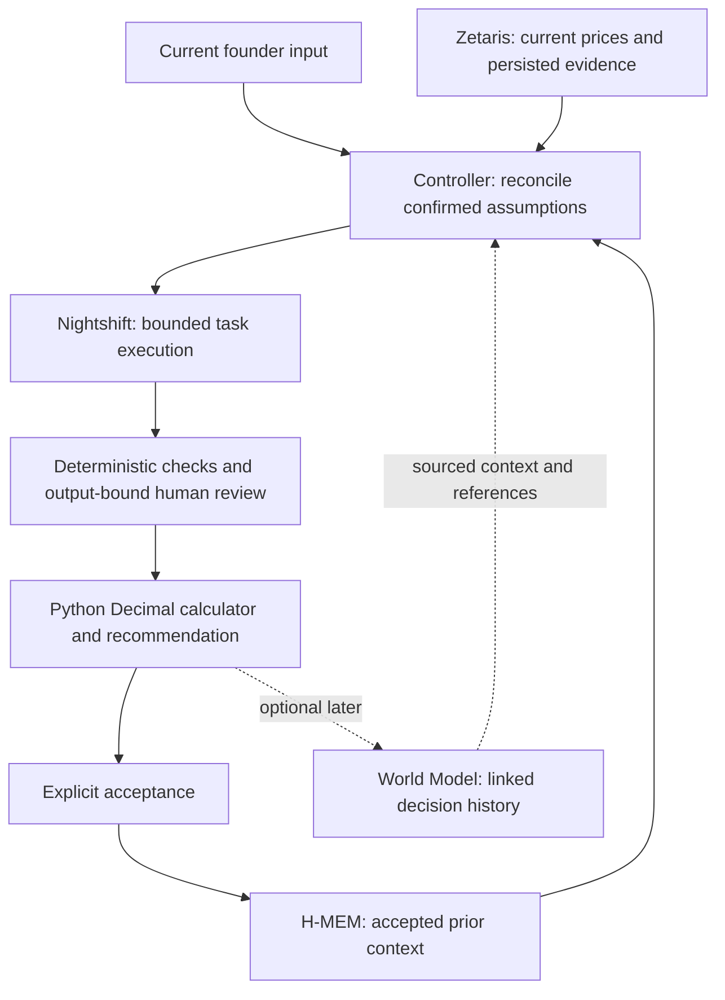

# Meterless engine fit for the cost advisor

Reviewed October 25, 2026 against the current cost-advisor working tree and upstream Meterless revision [`1742dec56a66e58eef9dda2d2b865823758ca8cd`](https://github.com/Meterless/Meterless/tree/1742dec56a66e58eef9dda2d2b865823758ca8cd/engines). This is a documentation/code review, not an installation, engine benchmark or implementation change.

## Decision

**Complete H-MEM first. Keep World Model as the first optional second engine. Do not add all four to the current submission.**

H-MEM directly supports the product's promised return visit: recall a founder's accepted assumptions and earlier decisions, rerun at a changed growth stage, and explain the difference. A second engine is worth adding only when it supplies independently testable behavior beyond the controller, typed contracts, source registry and evidence already being built.

The current best combination for a future persistent, multi-project advisor is **H-MEM + World Model**: memory supplies confirmed context, while the graph connects features, evaluations, model variants, reviews and decisions. For the existing bounded workflow, H-MEM alone has the clearest immediate value.

## What actually ships upstream

The [engine overview](https://github.com/Meterless/Meterless/blob/1742dec56a66e58eef9dda2d2b865823758ca8cd/engines/README.md) lists four engines. They are implementation specifications, not four published packages that become integrated after `npm install`.

| Engine | Available implementation material | Consequence for this repo |
|---|---|---|
| H-MEM | Runnable deterministic TypeScript reference, optional JSON persistence, conformance suite | A bounded offline bridge is feasible; disclose the deterministic hash embedder and reference-storage limitations |
| World Model | Runnable deterministic TypeScript reference, event log, JSON persistence, projections, conformance suite | Feasible as a later domain-state projection, with explicit IDs and a tested synchronization boundary |
| Markovian | Runnable deterministic TypeScript reference with injected generator, bounded carryover and run history | Real Nightshift/dispatch accounting must be wired for every generator/compression/reflection call |
| Scout Intent | Specification, contract examples and eval harness; no engine implementation or published `@meterless/scout` package | Adopting it requires building and evaluating a new decision layer; substantial current scope |

The three references have no runtime dependencies but use development tools such as tsx/vitest. This does not make installation unnecessary or establish production readiness. Pin sources, retain licences, document runtime versions and run the relevant tests. No reference tests were executed by this review.

## Fit by engine

### H-MEM: best fit now

**Question it answers:** What did this founder previously confirm or accept, and why was that recalled?

Useful records include accepted quality requirements, workload assumptions, output limits and links to earlier accepted decisions. On a later visit, recall them with project scope, provenance and supersession information; reconcile them with current input before planning or projection.

Example: a founder previously confirmed a concise-output requirement. At a new growth stage the advisor recalls that requirement, queries current pricing through Zetaris and reuses compatible prior measurements or asks for a new evaluation when the task changed. The output identifies workload, price and configuration changes separately. Any recommendation follows the actual evidence; the example does not guarantee a particular model wins.

**Current gaps:** the controller reads recalled memory IDs but does not apply returned context; save/recall kinds differ, and completion automatically saves a decision without distinct acceptance. Reference/conformance directories are now present locally, but `bridge.mjs` and `PINNED_REVISION` were still absent at inspection. Presence of installed files is not proof of a working bridge.

**Plan fit:** M07 proves real offline-capable persistence/delegation. M11 proves confirmed memory changes a later decision. These are separate requirements; installing the reference alone closes neither.

**Acceptance:** save an explicitly confirmed assumption, restart, recall it only in the right project, demonstrate its use, supersede it with a current confirmed input and retain an audit. Keep sample/live memory distinct. Current prices must still be queried through Zetaris, as required by Step 11 of [09](09-v4-Gap-Implementation-Guide.md).

Sources: [H-MEM](https://github.com/Meterless/Meterless/blob/1742dec56a66e58eef9dda2d2b865823758ca8cd/engines/hmem/README.md), [reference limitations](https://github.com/Meterless/Meterless/blob/1742dec56a66e58eef9dda2d2b865823758ca8cd/engines/hmem/reference/README.md).

### World Model: most useful second engine if persistent relationships become necessary

**Question it answers:** Which feature, task version, model variant, price snapshot, sample, review and decision belong together, and how did those relationships change?

A project graph could connect `feature → evaluated_with → model_variant`, `sample → reviewed_by → review`, and `accepted_decision → supported_by → sample/price_snapshot`. A dated graph lets the UI explain a change by traversing the source records rather than constructing an unsupported narrative.

**Incremental value:** shared cross-agent/domain state, explicit relationships, temporal history and provenance. This becomes useful when many projects or successive decisions need interactive comparison. Current contracts, source manifests and SQLite records may be sufficient for the small submission workflow; demonstrate that a graph answers something those structures do not already answer conveniently before adopting it.

**Integration cost:** entity design, exact identity mapping, persistence, replay, graph projections and synchronization. Use explicit provider/model/version IDs; the reference's fuzzy name resolution is unsuitable for automatically merging different priced variants. Keep append-only ingestion idempotence separate from paid-call idempotence: replaying an event safely does not establish that repeating an inference is safe.

**Zetaris boundary:** use the graph as a provenance-linked domain view of records obtained through Zetaris. Store references and dated observations, and fetch current tariff evidence through Zetaris. Do not create an independent authoritative pricing catalog in the graph or H-MEM, or describe the two engines as a replacement for Zetaris.

**Acceptance:** ingest an evaluation twice without duplicate facts, restart and rebuild the view, preserve distinct variants and project isolation, then trace a changed decision to exact sample/review/snapshot IDs. Show that stale facts cannot override the pinned source or current confirmed input.

Sources: [World Model](https://github.com/Meterless/Meterless/blob/1742dec56a66e58eef9dda2d2b865823758ca8cd/engines/world-model/README.md), [reference](https://github.com/Meterless/Meterless/blob/1742dec56a66e58eef9dda2d2b865823758ca8cd/engines/world-model/reference/README.md).

### Markovian: low immediate value for the present execution shape

**Problem it addresses:** repeated transmission of an expanding transcript across a long dependent reasoning chain.

Our current Nightshift adapter builds a fresh system/user message pair for each completion. Candidate executions are separate comparisons, followed by bounded critique and at most one repair; 30 dispatches do not imply a 30-step growing-context chain. The project's main cost projections concern the founder's feature workload, not an accumulating advisor conversation.

Markovian would be relevant to a later multi-step research mode that investigates many sources and carries decisions between dependent steps. Measure that real context-growth problem first. Compression can lose constraints or evidence, and its generator, compression and reflection operations can introduce additional calls. They must all pass through Nightshift and the existing durable dispatcher, within the agreed call/spend limits.

The upstream 73%/86%/91% figures are modeled comparisons with particular full-history baselines. They do not predict this application's cost or quality. Even `measured-run.ts` uses a mock generator and estimated token accounting by default; its name does not mean provider-metered usage. Treat it as a reference demonstration, not a new discount in the production calculator.

Sources: [Markovian](https://github.com/Meterless/Meterless/blob/1742dec56a66e58eef9dda2d2b865823758ca8cd/engines/markovian/README.md), [efficiency assumptions](https://github.com/Meterless/Meterless/blob/1742dec56a66e58eef9dda2d2b865823758ca8cd/engines/markovian/docs/efficiency-model.md), [reference accounting](https://github.com/Meterless/Meterless/blob/1742dec56a66e58eef9dda2d2b865823758ca8cd/engines/markovian/reference/README.md).

### Scout Intent: useful for a future conversational product, expensive now

**Question it answers:** Does the founder want a projection, a new evaluation, a review/acceptance action or a later-run comparison, and which tools are permitted?

That is useful when free-text requests require intent resolution and clarification. The current JSON entry point already uses typed input, explicit evaluation authorization, a state allowlist and a durable dispatcher. Scout would overlap with that layer rather than repair missing data adapters or make the calculator correct.

Scout is an implementation specification with an eval harness, so adopting it means implementing classification, policy, routing and contract verification. Keep controller authorization, verified rate checks and reservations authoritative even if a future Scout proposes a plan. An intent classifier's confidence cannot qualify model output, prove a billing bound or override user confirmation.

Source: [Scout Intent status and contract](https://github.com/Meterless/Meterless/blob/1742dec56a66e58eef9dda2d2b865823758ca8cd/engines/scout-intent/README.md).

## Is combining engines worth it?

| Combination | Fit for this use case | Recommendation |
|---|---|---|
| H-MEM alone | Accepted founder context and auditable repeat visits | Implement and demonstrate now |
| H-MEM + World Model | Persistent, sourced relationships and explanations across evaluations | First optional extension after the H-MEM workflow works |
| H-MEM + Markovian | Memory-seeded, genuinely long multi-step research | Use only if a measured long-chain requirement appears |
| H-MEM + Scout | Conversational intent routing informed by prior preferences | Later, when the user interface needs that decision layer |
| All four | Full memory/state/intent/long-reasoning platform | Too much integration and duplicated responsibility for the current scope |

These recommendations are engineering judgments based on our workload, not an upstream ranking or measured engine-performance result. More engines are not more agents and do not establish better collaboration. Sponsor value comes from a necessary function changing the output with attributable evidence.

## What the existing combined examples prove

The upstream [memory-compounding example](https://github.com/Meterless/Meterless/blob/1742dec56a66e58eef9dda2d2b865823758ca8cd/examples/memory-compounding-research/README.md) combines real H-MEM and Markovian references with a deterministic mock generator. Its cold/warm behavior intentionally skips preset settled steps in the warm case. It is useful for understanding the integration seam, not evidence that a real model will do less work or preserve quality on our tasks.

The World Model folder contains an actual [world-to-H-MEM sync program](https://github.com/Meterless/Meterless/blob/1742dec56a66e58eef9dda2d2b865823758ca8cd/engines/world-model/examples/world-to-hmem-sync/index.ts) that imports both references, subscribes to `assertFact` events and adds provenance-linked memories. In contrast, H-MEM's reciprocal `world-model-sync` README explicitly labels its own example a non-runnable sketch. Use executable files to establish the contract; illustrative README imports such as `@meterless/world-model` are not published packages.

No combined example was run for this review. Running a reference example later is a component check; a combined application acceptance test must still prove useful behavior in the cost advisor.

## Proposed H-MEM-first data flow

The World Model branch is a proposal, not an implemented path. If facts are synchronized to H-MEM later, make the direction and revision IDs explicit, suppress duplicate events and propagate supersession. Avoid a bidirectional write loop.

## Admission criteria for a second engine

1. Complete the real H-MEM M07/M11 behavior and retain its evidence before expanding scope.
2. Name a concrete question the second engine answers. For World Model: which changed source, reviewed sample or accepted constraint explains this decision change?
3. Compare with the simpler existing records on the same inputs. Keep the engine only if it improves a useful capability, traceability or measured operational behavior enough to justify its storage/sync surface.
4. Freeze the same task and permissible context across model candidates. Do not inject one candidate's earlier answers or approvals into another candidate's evaluation. Reuse evidence only with compatible task/prompt/rubric/model references.
5. Test provenance, replay, project isolation and stale/superseded context. Keep actual prices and measured evidence traceable through Zetaris, and all inference through Nightshift and the dispatcher.
6. Distinguish upstream reference/conformance PASS, local adapter PASS and live application evidence. No one of them substitutes for the others.

This review leaves the current v4 scope and milestone completion states unchanged. Its immediate recommendation is to finish the existing H-MEM promise, not to add another engine as a substitute for it.
