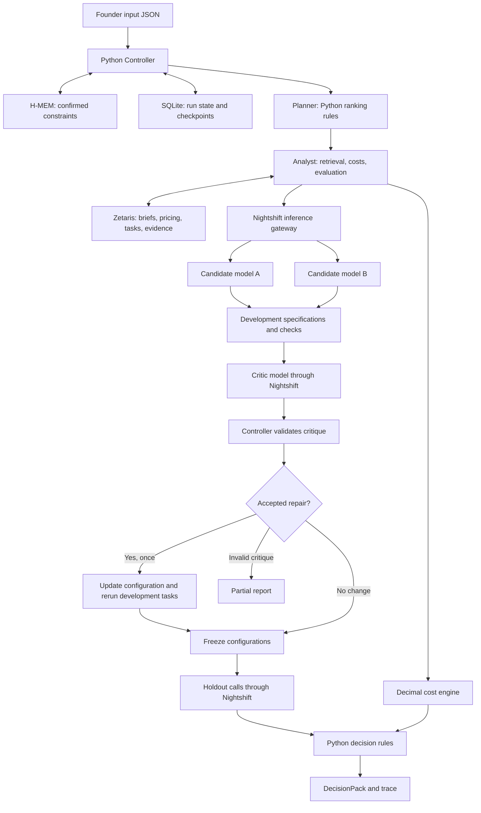

# App functionality, code flow, agent architecture, and model capabilities

This app is an **AI development cost and decision assistant**. It helps a founder answer:

> Given my product, budget, and technical ability, which AI development approach should I choose, what might it cost, and what evidence supports that choice?

The current interface takes a **JSON input file** and produces a **JSON recommendation report**. A website interface is still pending.

This document combines the user-facing workflow with the current implementation. Agent role names describe responsibilities inside one Python application. Models generate candidate specifications and critique evidence; Python controls planning, calculations, limits, repairs, and final selection.

## 1. Input: describe what you want to build

You provide:

| Input | Example |
|---|---|
| Product idea and target users | A backtesting tool for retail investors |
| First-version features | Data ingestion, backtesting, optimization, accounts |
| Feature size | Small, medium, large, extra large |
| Constraints | Budget, timeline, team size, technical skill, DevOps ability |
| Expected usage | Active users, workflows per month, AI calls per workflow |
| Revenue assumptions, if available | Subscription price and percentage of paying users |
| Evaluation permission and spending limit | Evaluation approved; maximum evaluation budget of $5 |

You also identify which information is verified, assumed, reconstructed, or unknown.

`cash_budget_usd` describes the founder's product build budget. `max_spend_usd` limits this app's evaluation inference spending. They serve different purposes.

The existing [example input](../input_examples/example_1.json) describes an investment backtesting product. **That product is the case being evaluated; this app itself is the decision assistant.**

## 2. Flow: validate your request

The app checks that the input matches the required structure and that the run ID has not already been used.

Invalid input produces a structured error. A duplicate run is refused to prevent repeating work.

In sample mode, the app uses the inline brief. In live mode, the request identifies a registered brief by ID and version; the app loads its content from Zetaris and checks the version and project association rather than accepting inline content as a replacement.

## 3. Flow: recall previously confirmed constraints

The app checks its persistent memory, H-MEM, for constraints you previously confirmed for this project.

For example, if an earlier run confirmed your budget and the new input omits it, the app can reuse it. An explicitly supplied current value takes precedence.

Only explicitly supplied, verified constraints from the active brief become confirmed memories automatically. Live fixture or unapproved records are not promoted to confirmed memories. A generated recommendation is not automatically treated as a finding accepted by the founder.

## 4. Flow: load development options and pricing

The bundled options include:

- A credit-based AI app builder.
- A managed coding agent with hosting.
- An IDE coding agent with your own hosting.
- A custom application using a hosted model API.

The app reads stored pricing snapshots and records their sources and verification status. Sample mode reads bundled JSON; live mode reads registered records through Zetaris. It does **not currently search the web for fresh prices during a run**.

## 5. Flow: calculate two separate cost estimates

| Estimate | What it calculates |
|---|---|
| **Build cost** | Feature-level development costs, assumed rework, low/base/high scenarios, and checkpoints for reassessing spending |
| **Operating cost** | Estimated monthly AI cost and cost per workflow; revenue, contribution, and margin when revenue assumptions exist |

Missing information stays unknown rather than becoming zero. Build and operating costs are kept in separate ledgers.

The current operating calculation assumes 1,500 input tokens and 600 output tokens per call. It uses the first configured candidate model when that model has a loaded pricing profile; otherwise it uses the first loaded model. It is an estimate, not a measurement of a deployed product's bills or a separate operating-cost comparison for every candidate.

Evaluation inference spending is tracked separately from both product cost ledgers.

## 6. Flow: select two candidate configurations

The app first filters options by your DevOps ability, then prioritizes verified pricing and budget fit.

Each candidate combines a development approach with a model.

**The current selection logic is rule-based.** Although the architecture calls this the “Planner,” the implemented ranking is deterministic.

In live mode, exactly two configured candidate route entries are assigned to the two configurations. If only one development approach is eligible, both configurations can use that approach.

If important missing information determines which approaches are eligible, the app can return `needs_input` with a question for the founder.

## 7. Flow: evaluate small development tasks

With evaluation approval, both candidates generate implementation specifications for tasks such as:

- Price-data ingestion.
- Rule-engine design.
- A backtesting runner.

The app checks that required elements contain text, that critical failure markers are absent, and that the cost note cites supplied pricing evidence IDs. These checks do not prove the semantic correctness of every specification or cost claim.

These are **specification checks**, not complete applications built and tested on each platform.

Without evaluation approval, the app returns `needs_input` before candidate evaluation. Spending reservations and generation limits can also stop a run with a partial report.

Before live inference, the app also requires approved records, discovered model routes, and dated, cited, verified input/output token rates for the configured models.

## 8. Flow: check gaps and allow one repair

The critic receives the development outputs, evaluation results, task rubrics, and source references. It checks for missing requirements or unsupported claims and returns a structured critique.

The controller validates case IDs, source IDs, action inputs, and repair targets. Allowed critic actions are `finalize`, `retrieve_evidence`, and `revise_prototype`; the permitted evidence re-query is limited to pricing snapshots. An invalid critique stops the run with a partial report before repair or holdout dispatch.

If a repair is accepted, the controller allows one revision, adds evidence-linked findings to the target configuration's workflow settings, and reruns its development tasks. The repair does not modify your product's source code or require a separate planning-model call.

## 9. Flow: freeze configurations and run unseen tasks

The app saves configuration snapshots and a SHA-256 digest before loading separate “holdout” tasks that were unavailable during development. It checks that the configurations have not changed before each holdout evaluation. There is no further critique or tuning after the freeze.

It chooses the recommendation primarily by holdout task passes. Ties preserve the earlier candidate order.

The leading candidate must pass every holdout task and its latest development checks. A pass requires all required elements, no critical failure markers, and a sourced cost note. If these gates fail, the report abstains from recommending a configuration. A run can be `complete` while its recommendation is absent because the quality gate failed.

The task sample is small, so a passing result does not establish general model accuracy or prove that the complete product will work.

## 10. Output: receive a decision report

The output contains:

- A recommended configuration when the quality gates pass, plus an alternative or the leading candidate when the app abstains.
- Reasons for the recommendation.
- Build and operating cost estimates.
- Development and holdout results.
- Critic findings and revisions.
- Frozen configuration snapshots and their digest.
- Risks, evidence sources, missing information, and follow-up questions.
- Usage-priced inference costs, outstanding reservations, and model/request attribution.
- A status: `complete`, `partial`, `needs_input`, or `failed`.
- A trace file recording the run's actions.

Input, setup, and operational errors can instead produce a structured error response.

## Overall flow

```text
Product brief
    ↓
Validation and confirmed memory
    ↓
Pricing and cost estimates
    ↓
Two candidate configurations
    ↓
Evaluation approval check
    ↓
Development task checks
    ↓
Critique and up to one repair
    ↓
Frozen configurations and unseen task checks
    ↓
Recommendation report and trace
```

## 11. Code execution flow

Execution starts in [`run.py`](../run.py). The main orchestration lives in [`Controller.run()`](../app/controller.py).

```text
run.py: main()
 │
 ├─ Read input JSON
 ├─ Validate as RunRequest
 ├─ build_controller()
 │    ├─ Sample: SampleDataLayer + RulePolicyInference + SampleMemory
 │    └─ Live: ZetarisDataLayer + NightshiftInference + HmemBridge
 │
 └─ Controller.run()
      ├─ Claim unique run ID in SQLite
      ├─ Load brief; recall and apply confirmed constraints
      ├─ Load approach and model pricing
      ├─ build_ledger() / operating_ledger() / _risks()
      ├─ _propose_configs() → select two configurations
      ├─ Check evaluation approval and _live_preflight()
      ├─ _run_case() → development tasks for both configurations
      ├─ _critique() → one structured evidence critique
      ├─ Validate critique; apply at most one repair
      ├─ _config_digest() → freeze configurations and save evidence
      ├─ _run_case() → unseen holdout tasks
      ├─ _decide() → recommend or abstain
      └─ Save DecisionPack in SQLite; write output JSON and trace
```

Both candidate and critic calls pass through the controller's `_complete()` method. It reserves spending before dispatch, checks model attribution and usage afterward, and settles the reservation using reported token counts and registered prices.

## 12. Agent architecture



The roles run sequentially inside one application. They are not separately deployed agent services.

| Component | Responsibility | Uses a model today? |
|---|---|---|
| Controller | Enforce approvals, spending, state transitions, limits, and validation | No |
| Planner | Filter approaches by DevOps capacity and rank by pricing and budget fit | No |
| Analyst | Retrieve evidence, calculate costs, dispatch task evaluations, and save results | Through candidate calls only |
| Candidate A/B | Produce implementation specifications for supplied tasks | Yes, in live mode |
| Critic | Identify evidence gaps and propose a bounded action | Yes, in live mode |
| Repair | Apply accepted critique findings to configuration context and rerun tasks | No separate planning model |
| Decision builder | Apply pass criteria and assemble the report | No |
| H-MEM | Persist and recall confirmed constraints through the Node bridge | No model required |

The [proposed architecture](../Planning/02-Technical-Architecture.md) describes broader model-driven planning. The current code uses deterministic planning and repair rules. A reserved “Planner” or “Revision” role slot is not itself an inference call.

### Data and operational boundaries

- **Zetaris** supplies registered domain records and the live evaluation evidence read path. The implemented local evidence writer uploads to LocalStack S3, registers a per-run table, and verifies exact readback through Zetaris. Other storage topologies require a supported writer.
- **H-MEM** stores compact, project-scoped confirmations and audit history. Its current reference uses deterministic hashing and local persistence; it does not need a semantic embedding API or a model provider.
- **SQLite** stores run identity, state, inference reservations, and the final pack. It is separate from project memory and the domain data layer.
- **Trace JSONL** records actions, state changes, model attribution, source references, and spending events.
- **Sealed sources** are restricted by controller state. Holdout tasks and retrospective actuals are unavailable through the guarded read path before freeze. The recorded local integration check does not establish server-side sealed-source permissions.

## 13. Model capabilities needed

| Role | Required capabilities | Example |
|---|---|---|
| Candidate models | Software design, detailed instruction following, schema-compatible JSON, supplied-source citation, and acknowledgment of unknown prices | Specify a backtesting runner with a window schedule, data split, result format, and compute limits |
| Critic model | Compare outputs with task rubrics, detect unsupported claims, reason across multiple cases, cite exact case/source IDs, and produce a valid action proposal | Identify missing rate-limit handling and request an evidence-linked repair for one configuration |
| Future model-driven Planner | Constraint reasoning, comparison of alternatives, permitted-action selection, and structured planning | Request missing pricing before choosing an approach; this capability is proposed, not currently invoked |

A candidate response must resemble the task-specific JSON structure below. The fields vary with the task rubric.

```json
{
  "schema": "Describe the price-bar record...",
  "caching": "Cache by ticker and date range...",
  "rate_limit_handling": "Use bounded retries...",
  "acceptance_tests": "Verify missing bars and duplicate dates...",
  "cost_note": {
    "text": "The supplied rate is unverified.",
    "evidence_ids": ["rate-builder-credit"]
  }
}
```

The critic returns `case_ids`, `findings`, `proposed_action`, and `expected_check` according to `CriticResponse`. Findings must link to actual development outputs and known evidence; a repair must target a supported configuration and development task.

### Runtime integration requirements

These requirements describe what the app sends and validates, rather than a certification that every available model route supports them.

| Requirement | Current implementation |
|---|---|
| Inference gateway | All model calls go through Nightshift chat completions; no direct-provider fallback |
| Structured responses | Requests include JSON Schema response formatting for candidates and the critic |
| Token usage | Valid input/output token counts are required to price live inference |
| Model identity | Requested routes must be discovered, and the resolved model must match the requested model |
| Context capacity | Candidates receive the brief, task, configuration, and relevant pricing; the critic receives all initial development outputs in one batch |
| Prompt bound | 48,000 UTF-8 bytes across system text, user text, and schema; this is a byte limit, not a token limit |
| Output bound | 1,024 tokens per request |
| Response behavior | Concise JSON that fits the output bound; incomplete responses or runtime review requirements stop live execution |

Native tool calling, web browsing, image understanding, audio, and code execution are not required by the current model interface. Python invokes the tools and performs arithmetic. The app does not request a separate model-generated final explanation.

### Model route configuration

Live configuration requires exactly two candidate route entries and a critic route:

```dotenv
METERLESS_CANDIDATE_MODELS=<candidate-route-a>,<candidate-route-b>
METERLESS_CRITIC_MODEL=<nvidia-nemotron-route>
```

The placeholders must be replaced with actual routes exposed by Nightshift model discovery. The current critic preflight requires a route starting with `nvidia/` whose name contains `nemotron`. These role assignments do not inherently require three distinct underlying models.

Each configured live model needs a registered profile containing dated, cited, verified per-million-token input and output rates. Provider credentials are managed in Nightshift; the app uses its runtime token.

### Expected model call count

The current live benchmark requires three development tasks and three separate holdout tasks.

| Work | Model calls |
|---|---:|
| Two candidates × three development tasks | 6 |
| One batched critique | 1 |
| Optional repair: rerun three development tasks for one candidate | 0–3 |
| Two candidates × three holdout tasks | 6 |
| **Successful full flow, excluding transport retries** | **13–16** |

There are no additional model calls for ranking, arithmetic, applying the repair, or report writing. The controller caps candidate generations at 23, allows one critique and at most one revision, and permits at most two transport retries globally for connection failures before delivery. Budget, validation, missing records, or runtime failures can stop execution sooner. Sample mode makes no network inference calls.

## 14. Spending and result interpretation

The app keeps three different amounts separate:

| Amount | Meaning |
|---|---|
| Build ledger | Estimated cost of developing the founder's product |
| Operating ledger | Estimated post-launch monthly cost and unit economics |
| Evaluation inference spending | Cost of the model calls made by this decision app |

For live evaluation, `_complete()` reserves a conservative amount before each request using prompt size, the output-token limit, and verified rates. It then calculates usage-priced spending from returned input/output token counts. This replaces the earlier fixed $0.05-per-generation description.

Usage-priced spending is not a reconciled provider invoice. If dispatch may have been billed but usage or model identity cannot be verified, spending is marked unknown instead of zero. Outstanding reservations and per-call cost records remain in the output.

## 15. Current implementation and limitations

The offline sample flow works using bundled data and rule-based responses. It runs the real H-MEM reference locally, makes no paid inference calls, and deliberately injects a missing-context development scenario to exercise critique and repair.

Live project-data mapping and local evidence writeback are implemented. The [recorded Stage 5 integration check](stage5_integration_check.json), dated October 25, 2026, verified registered brief/pricing/task reads, configured route discovery, the pre-freeze sealed-source guard, approval stopping behavior, and evidence ingestion with exact Zetaris readback. That check made **zero inference calls** and is not evidence of a completed paid candidate-and-critic benchmark. Approved founder/task records and dated prices for the configured routes are still required.

Bundled pricing snapshots are placeholders marked unverified. Sample recommendations demonstrate the workflow rather than establish a reliable purchasing decision. When no eligible approach has verified pricing, approach order reflects snapshot order rather than proven cost superiority.

Evaluation checks implementation specifications rather than executing complete products on the compared platforms. Required-field presence and source-ID checks do not establish correctness, and human review remains pending. Small task samples do not establish general model accuracy or measured savings.

A website interface is still pending. The current output is a JSON decision pack with an accompanying trace.

## Code references

- [Example input](../input_examples/example_1.json)
- [CLI entry point](../run.py)
- [Input and output contracts](../app/contracts.py)
- [Main application flow](../app/controller.py)
- [Cost calculations](../app/economics.py)
- [Evaluation spending calculations and limits](../app/spending.py)
- [Offline sample adapters](../app/adapters/sample.py)
- [Nightshift live inference](../app/adapters/live.py)
- [Zetaris reads and local evidence writeback](../app/adapters/zetaris.py)
- [H-MEM bridge and setup](../app/engines/hmem/README.md)
- [Proposed technical architecture](../Planning/02-Technical-Architecture.md)
- [Recorded local integration check](stage5_integration_check.json)
